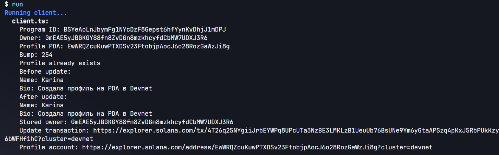
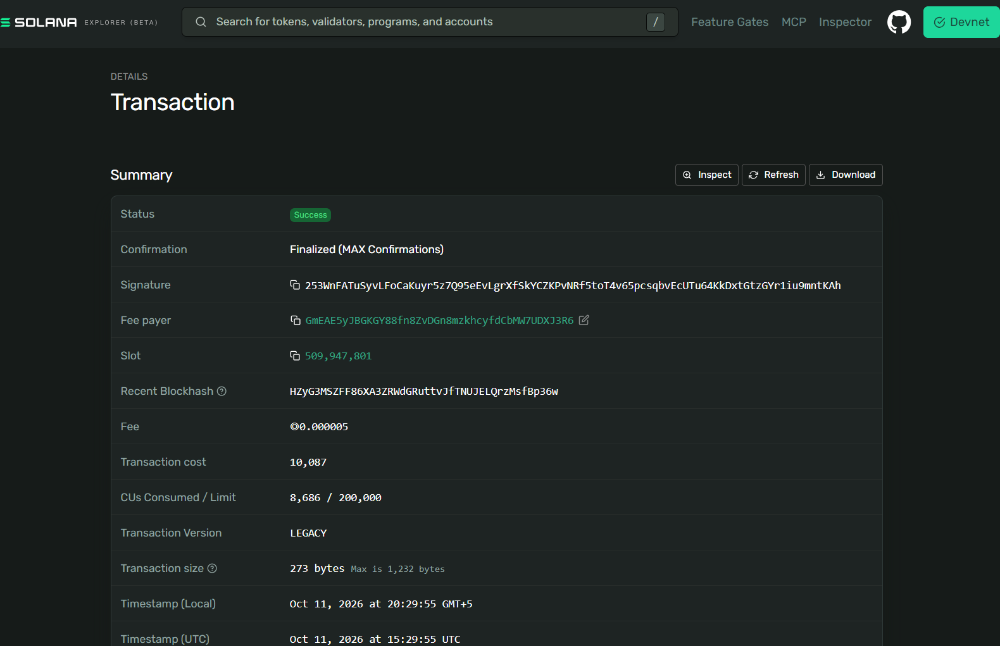
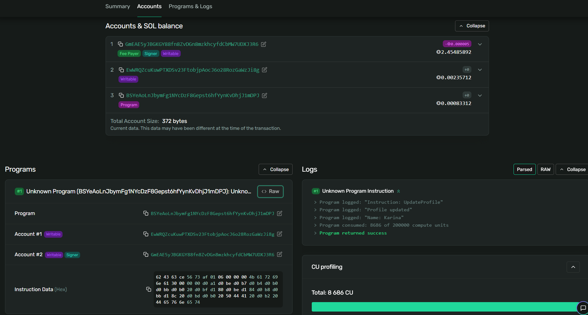
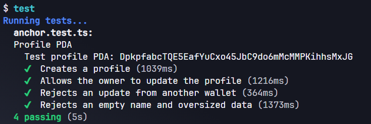

# Задание 6 — Профиль пользователя на PDA

Программа на Rust с использованием Anchor, развёрнутая в Solana Devnet. Позволяет создать профиль пользователя и обновлять его данные через TypeScript-клиент.

## Возможности

- Создание профиля с именем и описанием.
- Хранение адреса владельца, имени и описания в блокчейне.
- Обновление профиля только его владельцем.
- Проверка данных: имя не должно быть пустым, максимальная длина имени — 32 байта, описания — 256 байт.

## PDA и устройство аккаунта

Адрес профиля вычисляется из seeds: строки `profile` и публичного ключа владельца, с использованием Program ID и bump.

У каждого кошелька есть свой адрес PDA для профиля в этой программе. Для PDA не создаётся отдельная пара ключей.

Аккаунт Profile содержит:
- owner — публичный ключ владельца;
- name — имя;
- bio — описание.

При создании аккаунта выделяется 336 байт, включая 8 байт дискриминатора Anchor.

При обновлении программа проверяет PDA через seeds и bump, подпись владельца через Signer и совпадение владельца с полем owner через has_one.

## Адреса в Devnet

Program ID:
`BSYeAoLnJbymFg1NYcDzF8Gepst6hfYynKvDhjJ1mDPJ`

Владелец профиля:
`GmEAE5yJBGKGY88fn8ZvDGn8mzkhcyfdCbMW7UDXJ3R6`

PDA профиля:
`EwWRQZcuKuwPTXDSv23FtobjpAocJ6o28RozGaWzJi8g`

Bump: `254`

- [Программа в Solana Explorer](https://explorer.solana.com/address/BSYeAoLnJbymFg1NYcDzF8Gepst6hfYynKvDhjJ1mDPJ?cluster=devnet)
- [Аккаунт профиля](https://explorer.solana.com/address/EwWRQZcuKuwPTXDSv23FtobjpAocJ6o28RozGaWzJi8g?cluster=devnet)
- [Успешная транзакция обновления профиля](https://explorer.solana.com/tx/253WnFATuSyvLFoCaKuyr5z7Q95eEvLgrXfSkYCZKPvNRf5toT4v65pcsqbvEcUTu64KkDxtGtzGYr1iu9mntKAh?cluster=devnet)

## Файлы

- src/lib.rs — программа Anchor.
- client/client.ts — вычисление PDA, создание, чтение и обновление профиля.
- tests/anchor.test.ts — тесты программы.

## Запуск в Solana Playground

1. Создать проект Anchor в Solana Playground.
2. Перенести файлы программы, клиента и тестов в соответствующие папки.
3. Выбрать Devnet и пополнить кошелёк тестовыми SOL.
4. Выполнить build и deploy. При развёртывании своей копии использовать её Program ID в declare_id!.
5. Выполнить run для запуска клиента.
6. Выполнить test для запуска тестов.

Клиент создаёт профиль, если его ещё нет, затем обновляет данные и выводит ссылки на транзакцию и аккаунт.

## Тестирование

Результат: 4 passing.

Проверки:
1. Создание профиля и сохранение данных владельца.
2. Обновление профиля владельцем.
3. Отклонение обновления чужим кошельком без изменения данных.
4. Отклонение пустого имени и превышения допустимой длины без изменения данных.

Тесты используют отдельные кошельки и отдельный PDA.

## Скриншоты

### Результат клиента

### Успешная транзакция обновления

### Логи программы

### Результат тестов

